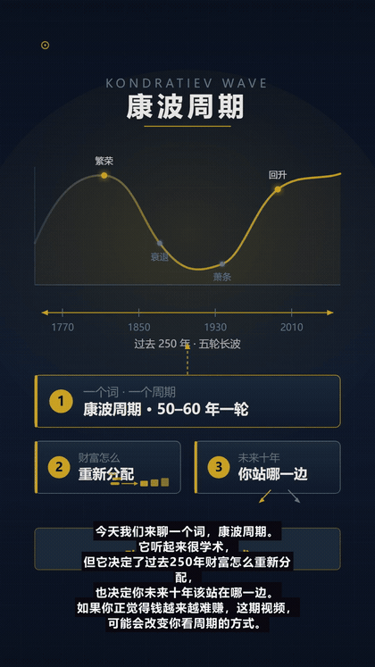

# Lyric Motion Studio · AI Video Studio

Turn a piece of text into a vertical short video where **every shot matches the line**: lyrics, a spoken script, a history topic, or just a theme.
The LLM decides the visual form of each shot (infographic, text card, illustration, diagram), then the pipeline handles voice-over, subtitles, music, cover art and a publishing pack, and renders locally with ffmpeg — no editing skills required.



> Works without an API key too: text and visuals fall back to local deterministic engines. Add a DeepSeek key to switch to real model-generated SVG frames.

[中文文档](./README.md)

## Features

- **Multiple inputs**: lyrics (LRC / online search), history topics (auto web research), spoken scripts / themes (≥120 chars preserved verbatim, split into segments)
- **LLM-drawn frames**: each shot is a complete SVG written by DeepSeek — style is decided by the content (no preset pixel-art, no templates), and in-frame text, arrows, highlights and leader lines are allowed
- **Automatic opening line**: if the script doesn't greet the viewer, it prepends “今天我们来聊「topic」.”
- **Target duration**: 30 s – 4 min; the script is expanded or trimmed to fit the target instead of slowing the narration
- **Default 1.3× speech rate** (Edge-TTS, `zh-CN-XiaoxiaoNeural`)
- **Subtitle safe areas**: small bottom subtitles with a translucent backing, automatic line wrapping, no overlapping events; 260 px bottom / 100 px sides / 140 px top kept clear for the Douyin player UI
- **Cover**: an infographic poster cover (1080×1920) is generated during rendering
- **Publishing pack**: video, cover, Douyin title, description and hashtags, each copyable from the UI
- **Daily mode**: topic library (or your own topic / script) → project → render → export package

## Stack

| Layer | Choice |
| --- | --- |
| Frontend | React 19, React Router, TanStack Query, esbuild |
| Backend | Node.js ≥ 24 (native TS stripping), Express 5, `node:sqlite` |
| Model | DeepSeek `deepseek-chat` (script, storyboard, SVG frames, publishing copy) |
| Frames | Native SVG → headless Chrome screenshot at 1080×1920 |
| Voice | Edge-TTS (`msedge-tts`) |
| Render | ffmpeg (still shots, ASS subtitles, mixing, MP4) |

## Pipeline

```
source → research? → analysis → storyboard → prompts → images → voice → music → render
```

## Quick start

Requires **Node.js ≥ 24**, **ffmpeg** (on `PATH` or via `FFMPEG_PATH`), and **Chrome / Edge** (for SVG rasterization).

```bash
git clone https://github.com/a18334761226-spec/lyric-motion-studio.git
cd lyric-motion-studio
npm install
cp .env.example .env     # optional: set DEEPSEEK_API_KEY
npm run build
npm start                # http://127.0.0.1:5099
```

Development: `npm run dev`.

## Commands

```bash
npm run typecheck
npm run build
npm run smoke
node --import ./scripts/ts-loader.mjs scripts/daily-video.ts --dry
```

Daily mode requires `DEEPSEEK_API_KEY` and outputs to `data/exports/<date>-<topic>/`:
`video.mp4`, `cover.png`, `script.txt`, `title.txt`, `desc.txt`, `tags.txt`, `meta.json`.

## Security & privacy

- No API keys are committed. Provide them via `.env` or the in-app Settings page (stored in the local `data/` database).
- `data/`, `screenshots/`, media assets and build output are git-ignored.
- If you ever hard-coded a key locally, revoke it and generate a new one.

## About auto-posting to Douyin

Douyin does not expose a public API for personal accounts to publish videos programmatically; unofficial automation violates its terms. This project only produces a **publishing pack** that you upload manually (enterprise accounts may use the official Open Platform APIs).

## License

[MIT](./LICENSE)
