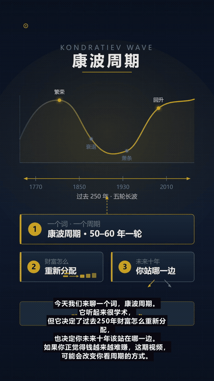
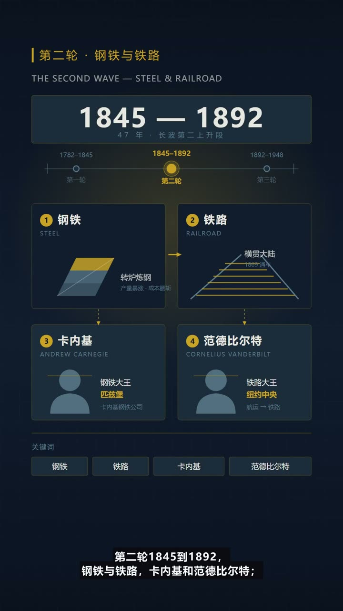
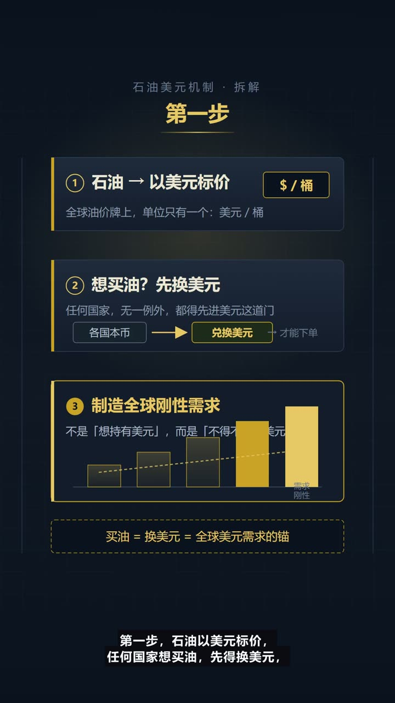
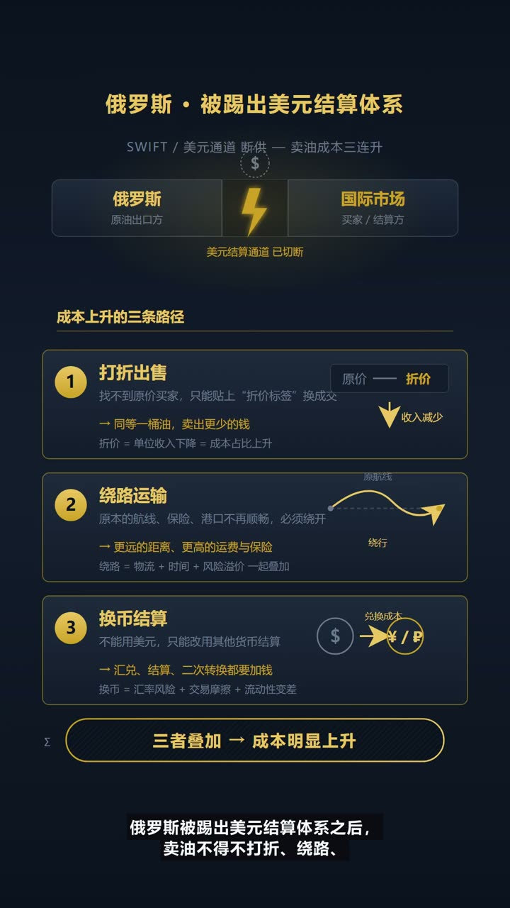
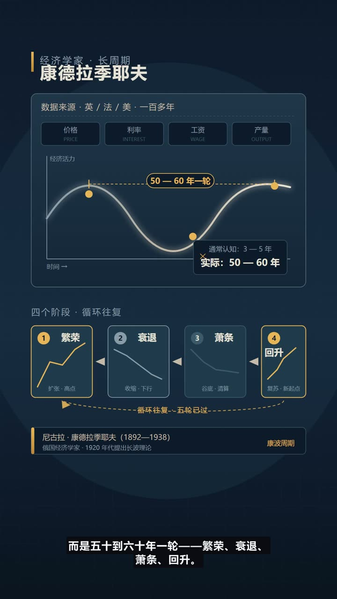
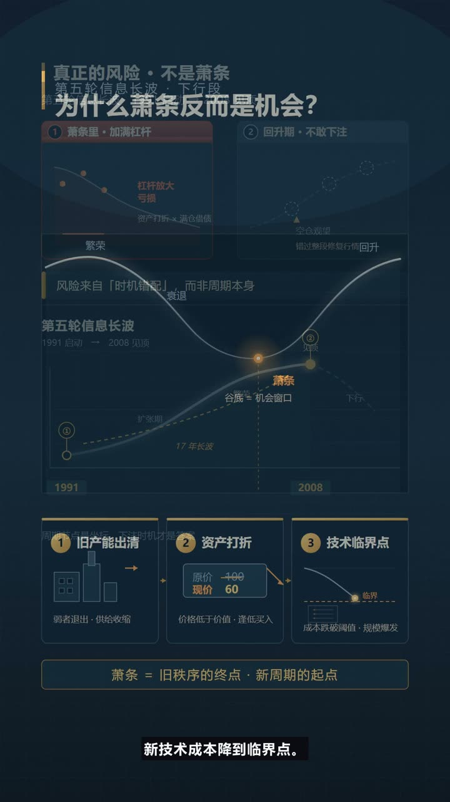

# Lyric Motion Studio · AI 成片工作台

把一段文字变成一支「每一镜都对得上」的竖屏短视频：**歌词、口播稿、历史资料、一个主题**都可以。
LLM 逐镜决定画面形式（信息图 / 文字卡 / 插画 / 示意图），自动配音、字幕、配乐、封面与发布包，本地 ffmpeg 渲染，不需要剪辑基础。



> 没有 API Key 也能跑通流程：文案与画面走本地确定性引擎降级；填上 DeepSeek Key 后切换为真实模型逐镜生成画面。

[English](./README.en.md)

---

## 样片

<table>
<tr>
<td></td>
<td></td>
<td></td>
</tr>
<tr>
<td></td>
<td></td>
<td></td>
</tr>
</table>

▶ **60 秒样片**：[docs/samples/demo-60s.mp4](docs/samples/demo-60s.mp4)（3 支成片各截 20 秒，720p）

### 一条命令看效果（不需要任何 API Key）

```bash
npm install
npm run demo
# 用内置演示画面 + Edge-TTS 配音，渲染出一支约 35 秒成片
# 产物：data/projects/<新项目 id>/out/video.mp4
```

演示只跑「配音 → 配乐 → 合成」，跳过需要模型的文案 / 分镜 / 画面阶段，所以开箱即可验证渲染链路。

## 它能做什么

- **多来源输入**：歌词（LRC / 在线歌词）、历史主题（自动联网检索）、口播稿 / 主题（≥120 字保留原文，逐段成镜）
- **LLM 逐镜画面**：每个镜头由 DeepSeek 直接输出完整 SVG，风格由内容决定（不预设像素风、不套模板），允许画面内文字、箭头、高亮与引线
- **自动开场白**：内容没有问候语时自动补「今天我们来聊「主题」」，不再上来就讲
- **时长可控**：目标时长（30 秒–4 分钟）→ 自动扩写 / 精简文稿到目标字数（保留事实与观点），而不是拖慢语速
- **1.3 倍语速**：默认 `voice.rate = +30%`，可在页面调整
- **字幕安全区**：底部小号字幕 + 半透明底衬，自动折行、相邻字幕不重叠；画面底部 260px、左右 100px、顶部 140px 不放关键内容（适配抖音播放页 UI）
- **封面**：渲染时自动生成信息图海报封面（1080×1920）
- **发布包**：成片 / 封面 / 抖音标题 / 简介 / 话题，页面内一键复制
- **每日出片**：选题库轮换或自定义选题、自定义口播稿 → 自动建项目 → 渲染 → 导出发布包

## 为什么便宜、也不用好硬件

这是一个**没有生图模型、没有 GPU、没有云渲染**的方案：

| 环节 | 常见做法 | 本项目 |
| --- | --- | --- |
| 画面 | 调文生图 API / 跑 Stable Diffusion | **DeepSeek 文本模型直接写完整 SVG**，再用 Chrome headless 截图 —— 没有一张图片 token，不需要显存 |
| 配音 | 云端 TTS 按字数计费 | Edge-TTS，**免费** |
| 配乐 | 素材库 / 版权音乐 | 本地程序化合成（可选 DeepSeek 设计参数），**免费** |
| 渲染 | 云渲染 / 剪映会员 | 本机 ffmpeg，**免费** |
| 硬件 | 至少 8–12GB 显存的显卡 | **纯 CPU 即可**，4–8GB 内存的普通笔记本 / 小主机能跑 |
| 成本 | 一张图几分钱 × 几十镜 + 云渲染费 | 一支 3 分钟视频约 20–30 次**文本**调用（几万 token），按 `deepseek-chat` 价格通常只要**几分到几毛钱** |

代价是渲染时间：普通 CPU 出一支 3 分钟成片约 5–10 分钟（主要是 ffmpeg 编码）。

### 成本对比（估算）

口径：**一支 3 分钟竖屏成片 ≈ 25 个镜头 / 1100 字文稿**，每月 30 支。

| 方案 | 单支成本 | 每月 30 支 | 需要硬件 | 额外支出 |
| --- | --- | --- | --- | --- |
| 文生图 API（每镜一张，含重试） | 25–75 张 × ¥0.1–0.5 ≈ **¥5–20** | ¥150–600 | GPU 可不用，但按张付费 | 云 TTS、素材版权、剪辑软件 |
| Stable Diffusion 本地 | 电费 **≈ ¥0.1–0.3** | ≈ ¥3–10 | **8–12GB 显存**显卡 | 模型/环境调试时间 |
| 剪映等剪辑软件 + 素材 | **¥0**（会员 ¥30–88/月） | ¥30–88 + 人工剪辑 | 普通电脑 | 会员、素材库、模板 |
| **本项目** | 文本调用 ¥0.1–0.5 + 电费 ¥0.05–0.15 ≈ **¥0.2–0.7** | **≈ ¥6–20** | **纯 CPU，4–8GB 内存** | 无（Edge-TTS / ffmpeg / Chrome 均免费） |

> 价格为公开报价的量级估算，随服务商、模型版本与使用量浮动；本项目只计 DeepSeek 文本 token 与本地电费，不含人工审稿时间。

### 实测：一支 3 分钟片到底花多少

环境：普通 CPU（无 GPU）、`deepseek-chat`、Edge-TTS、1080×1920，文案 1042 字 / 23 镜。

| 指标 | 实测值 |
| --- | --- |
| 成片 | 2 分 59.7 秒 |
| 生成耗时 | 约 5.8 分钟（含 26 次逐镜 SVG 绘制，每次一次文本调用） |
| LLM 调用 | 29 次：内容理解 1 / 文稿精简 1 / 逐镜画面 26 / 配乐设计 1 |
| token | 输入 26,769 + 输出 92,728 ≈ **119,497** |
| 模型费用 | **≈ ¥0.80**（DeepSeek 输入 ¥2/M + 输出 ¥8/M，按未命中缓存估算） |
| 成片大小 | 21.7 MB |

> 对比：同样 26 个镜头走文生图 API，按每张 ¥0.1–0.5 也要 ¥2.6–13，还不含失败重试；token 用量会随文案长度与重试次数浮动。
> 逐镜画面占 99% 的输出 token —— 因为每一镜都是模型现写的完整 SVG，而不是调一次生图接口。

## 技术栈

| 层 | 选择 |
| --- | --- |
| 前端 | React 19 + React Router + TanStack Query，esbuild 打包 |
| 服务端 | Node.js ≥ 24（原生 TS 剥离）、Express 5、`node:sqlite` |
| 模型 | DeepSeek `deepseek-chat`（文案、分镜、SVG 画面、发布文案）—— **画面也走文本模型，不调用任何文生图接口** |
| 画面 | LLM 输出原生 SVG → Chrome headless 截图 1080×1920（纯 CPU，无 GPU 依赖） |
| 配音 | Edge-TTS（`msedge-tts`，默认 `zh-CN-XiaoxiaoNeural`，免费） |
| 渲染 | ffmpeg（静止镜头、ASS 字幕、混音、合成 MP4，本地免费） |

## 流水线

```
source → research? → analysis → storyboard → prompts → images → voice → music → render
```

- `analysis`：理解内容；口播稿 / 长文保留原文，按句切段并补开场白；按目标时长扩写 / 精简
- `storyboard`：保留原文时一段一镜、静止画面；歌词项目按句成镜
- `images`：逐镜调 DeepSeek 生成完整 SVG → Chrome headless 渲染 PNG
- `voice` / `music`：Edge-TTS 逐段配音 + 程序化 BGM 设计
- `render`：ffmpeg 合成 + ASS 字幕 + 自动封面

## 快速开始

需要：**Node.js ≥ 24**、**ffmpeg**（PATH 可用或设置 `FFMPEG_PATH`）、**Chrome / Edge**（用于 SVG 截图）。

```bash
git clone https://github.com/a18334761226-spec/lyric-motion-studio.git
cd lyric-motion-studio
cd lyric-motion-studio
npm install
cp .env.example .env     # 可选：填 DEEPSEEK_API_KEY；不填会降级本地引擎

npm run build
npm start                # http://127.0.0.1:5099
```

开发模式：

```bash
npm run dev              # 同时启动 API 与前端 watch
```

## 常用命令

```bash
npm run typecheck        # tsc 全量类型检查
npm run build            # 构建 Web + Server
npm run smoke            # 冒烟测试
node --import ./scripts/ts-loader.mjs scripts/daily-video.ts --dry   # 每日出片：只写稿建项目
```

每日自动出片需要 `DEEPSEEK_API_KEY`，输出到 `data/exports/<日期>-<选题>/`：
`video.mp4`、`cover.png`、`script.txt`、`title.txt`、`desc.txt`、`tags.txt`、`meta.json`。

## 目录结构

```
src/
  server/          Express API、流水线、SQLite、服务
    services/      svgDirector（LLM 逐镜 SVG）、composer、ffmpeg、tts、pipeline…
  web/             React 控制台（控制台 / 新建成片 / 项目工作区 / 设置）
  shared/          类型与预设（默认语速、字幕、风格）
scripts/           构建、开发、每日出片
config/            默认选题库 topics.json
public/            静态入口（构建产物 public/build）
data/              运行时数据（项目、导出、SQLite）—— 已在 .gitignore
```

## 安全与隐私

- 本仓库**不包含**任何 API Key；请使用环境变量或页面设置（设置页写入本地 `data/` 数据库）
- `data/`、`screenshots/`、构建产物均被 `.gitignore` 忽略，不会提交
- 若曾在本地硬编码过 Key，请到 DeepSeek 控制台**吊销并重新生成**

## 关于「自动发抖音」

抖音未对个人号开放程序直发视频的公开 API；非官方自动化违反平台协议且有封号风险。
本项目只生成**发布包**，由你在抖音创作者中心手动上传；企业 / 机构资质可通过官方开放平台接入发布接口。

## English TL;DR

AI text-to-short-video studio: input lyrics, a spoken script, a history topic or just a theme. DeepSeek writes each shot as a complete SVG (infographic / text card / illustration chosen by the model), rasters it with headless Chrome, narrates with Edge-TTS (1.3× by default), burns bottom subtitles with Douyin-safe margins, and renders locally with ffmpeg. Target duration expands or trims the script instead of slowing the voice. Daily mode generates a topic-based video plus a publishing pack (video / cover / title / description / hashtags) — no auto-posting to Douyin, by design.

## License

[MIT](./LICENSE)
